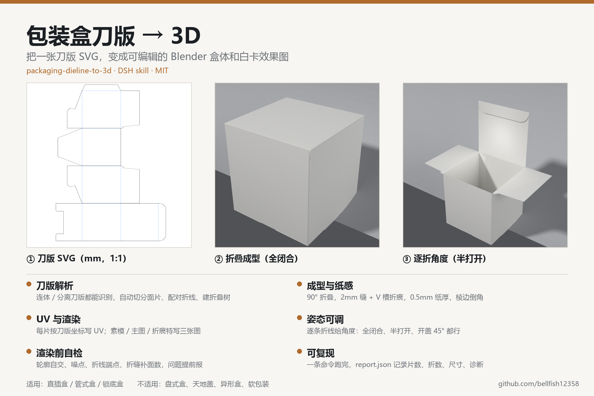

# packaging-dieline-to-3d

把**包装盒刀版图（die-line）**变成可编辑的 Blender 盒体，并渲染白卡效果图的一个技能包（给 DeepSeek Harness / DSH 用）。



> 这个仓库是本地已安装版本的备份。电脑坏了、误删了，都可以从这里拉回来。

## 功能简介

| 能力 | 说明 |
|---|---|
| **刀版解析** | 读 `<g id="cut">` 的刀线路径和 `<g id="fold">` 的折线；连体刀版自动按折线切分，分离刀版跨 2mm 缝配对。一个典型直插盒 = 13 片 / 12 折 |
| **折叠成型** | 按邻接关系建折叠树，自动判断折向（印刷面朝外），一次折到 90°；粘口、防尘翼、插舌、锁底都按刀版真实形状折进去 |
| **折缝与纸厚** | 面片之间留 2mm 缝，用 V 槽补面（深 0.25mm）补成折痕；纸厚 0.5mm 沿法线加厚，棱边倒角 0.5mm / 3 段 |
| **UV** | 每块面片的 UV 直接取它在刀版里的平面坐标，按整张刀版归一化；拿到 Blender 里就能按刀版位置贴图文，不用重新展 UV |
| **开合状态** | 逐条折线可单独给角度（`--pose`）：全闭合、半打开、开盖 45°、插舌回折都能出；负值表示反向折（防尘翼外翻） |
| **自动朝向** | 判断「管轴」方向并自动立正：管轴沿刀版 y 时绕 X 转正，沿 x 时绕 Y 转正；朝上的那一端不合意可以 `--flip-up` |
| **三张交付图** | `clay.png` 素模验几何、`render.png` 主图、`closeup_crease.png` 折痕/板厚特写；1200×1200，Cycles 64 spp |
| **布景自适应** | 相机、背景、灯位、盒内补光都按折叠后的包围盒自动算，换盒型不用改坐标 |
| **渲染前自检** | 预检查轮廓自交、噪点、折线端点是否落在顶点、轮廓是否相接；构建时给每条折线的切分日志、折缝补面计数，问题在出图前暴露 |

**适用**：直插盒 / 管式盒 / 锁底盒（四立面 + 插舌 + 防尘翼 + 粘口）。
**不适用**：盘式盒（天地盖、抽屉盒）、异形盒、曲面盒、软包装；不做印刷分色和图文对位。

## 输入 → 输出

```text
刀版 SVG ──► 解析 ──► 切分/配对 ──► 折叠树 ──► 2mm 缝 + 折痕
        ──► 纸厚/倒角 ──► UV ──► 布景 ──► clay / render / closeup
```

输入：毫米 1:1 的刀版 SVG（`cut` / `fold` 两个 group，坐标即最终尺寸，不支持 transform 和曲线）。
输出：`carton.blend`（可编辑场景）、`render.png`、`closeup_crease.png`、`clay.png`、`report.json`、`dieline_2mm_gap.svg`、`run.log`。

## 目录

| 路径 | 说明 |
|---|---|
| `SKILL.md` | 技能说明（给 AI 看的完整工作流） |
| `scripts/build_box.py` | 主脚本：解析 → 折叠 → 加厚 → 倒角 → UV → 布景 → 渲染 |
| `scripts/preflight.py` | 刀版预检，不启动 Blender |
| `scripts/run_build.ps1` | Windows 启动器：自动找 Blender、跑预检、写日志 |
| `scripts/install.ps1` | 安装到 `~/.agents/skills`（已存在时先备份） |
| `examples/` | 两个冒烟样例（分离刀版 13 片 / 连体刀版 5 轮廓） |
| `reference/` | 参数、SVG 规范、排错手册 |
| `docs/overview.png` | 上面那张功能简介图 |
| `CHANGELOG.md` | 版本改动 |

## 环境

- Windows（启动器是 PowerShell）
- Blender **5.1.2**（只用自带 bpy，不需要第三方包）
- Python 3（只有预检用；没有也能跑，`run_build.ps1` 会跳过预检）
- 可选：在 `~/.dsh/dsh-blender.config.json` 里写 `{"blenderExe":"...\\blender.exe"}`，启动器会自动找到 Blender

## 安装

把整个文件夹复制到：

```text
C:\Users\<你的用户名>\.agents\skills\packaging-dieline-to-3d
```

或者在这个文件夹里运行：

```powershell
powershell -ExecutionPolicy Bypass -File install.ps1
```

装完新开一个 DSH 会话就能被识别。

## 使用

```powershell
# 先出素模验几何
powershell -ExecutionPolicy Bypass -File scripts\run_build.ps1 -Svg "刀版.svg" -OutDir "output" -Quick

# 几何没问题再出完整渲染
powershell -ExecutionPolicy Bypass -File scripts\run_build.ps1 -Svg "刀版.svg" -OutDir "output"

# 半打开的姿态：折线序号=角度，负值=反向折，0=不折
powershell -ExecutionPolicy Bypass -File scripts\run_build.ps1 `
  -Svg "刀版.svg" -OutDir "output_open" -Pose "8=-90,9=-90,10=0,11=175"
```

折线序号就是 `<g id="fold">` 里 `<line>` 的先后顺序（从 0 开始），`report.json` 的 `split_log` 里每条都带坐标可以对照。

## 已知限制

- 只做管式盒；盘式盒、天地盖、异形盒、软包装不在范围内。
- 折线**中段**的局部切口（比如盖/插舌折线中间的半月拇指缺口）不支持——切分只认整段直线。
- 盒角会留 1–2mm 细缝（2mm 缝在折线端点截止），渲染里是一条细亮线，不是通缝。
- `--pose` 只改折角，不解决穿模；折到 0°/180° 附近要留 2–5° 余量。

## 版本

v2（2026-10-30）：新增逐折角度、自动判断立起方向、切分诊断、预检增强、布景自适应。改动明细见 [CHANGELOG.md](CHANGELOG.md)。

## 许可

[MIT](LICENSE) © 2026 Wang Zhiyu
